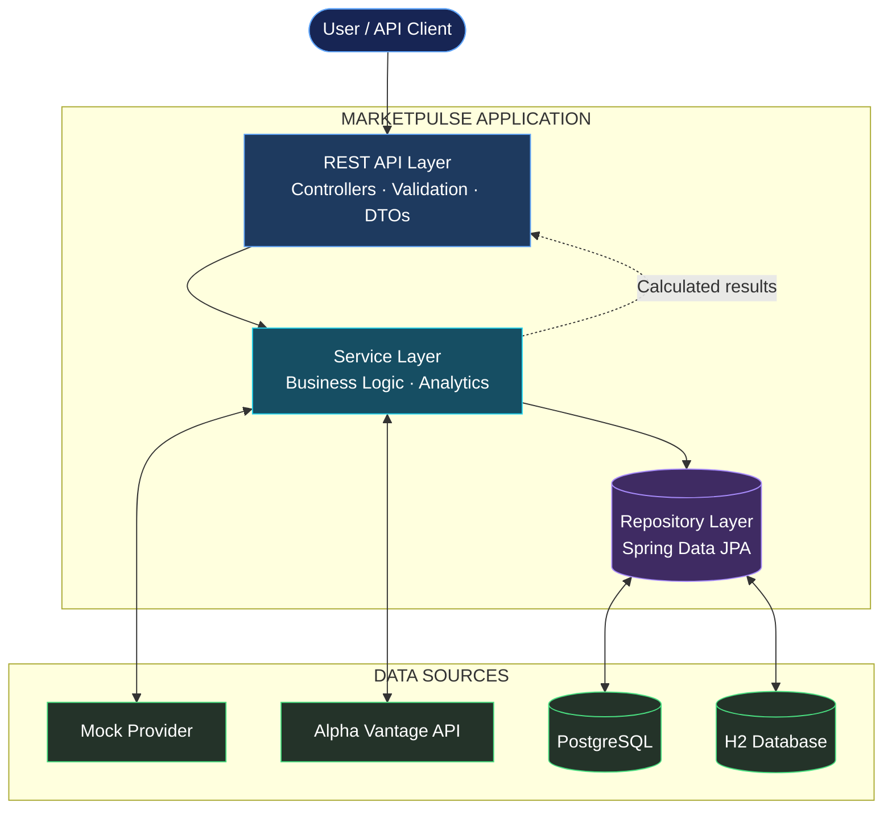

# MarketPulse — Market Data Analytics API

A market data analytics platform built with Java 21 and Spring Boot that stores historical stock prices, exposes REST APIs for financial data, and calculates price movements and simple moving averages. Includes a web dashboard for exploring instruments, viewing price history, and inspecting API responses.

## Output & Screenshots


## -


## Overview

MarketPulse combines financial data retrieval, persistent storage, and quantitative analytics in a single application. It is designed as a modular monolith, keeping the codebase straightforward to understand, test, and extend.

**Core capabilities**

- Retrieve financial instrument metadata.
- Synchronize historical market prices from a configurable data provider.
- Store daily price records in a relational database.
- Calculate daily absolute and percentage price changes.
- Calculate simple moving averages over configurable periods.
- Explore data through a browser-based analytics dashboard.
- Inspect and test endpoints through Swagger UI.
- Run automated tests without requiring a live market data API key.

## System Architecture

MarketPulse follows a layered modular-monolith architecture, with a clear path from incoming requests to market data retrieval, persistence, and analytics.



### How the Data Flows

1. **Request:** A browser or API client requests instrument details, historical prices, or analytics.
2. **Processing:** REST controllers validate inputs and delegate business operations to the service layer.
3. **Data retrieval:** Services use repositories to access stored market data or a provider to retrieve external prices.
4. **Analytics:** The application calculates daily price changes and moving averages using `BigDecimal`.
5. **Response:** The controller returns structured JSON, which can be consumed by API clients or displayed on the web dashboard.

### Design Philosophy

- **Simple deployment:** One Spring Boot application keeps development and deployment manageable.
- **Clear boundaries:** Controllers, services, repositories, and providers each have distinct responsibilities.
- **Flexible data sources:** The provider interface allows mock data and external market data to be used through the same application flow.
- **Reliable calculations:** Financial arithmetic and validation are handled in the service layer.
- **Persistent history:** Database records support repeatable analytics without requiring a fresh provider request for every query.

The application uses a layered architecture with clear responsibilities:

| Layer | Responsibility |
|---|---|
| Controllers | Handle HTTP requests, validate inputs, and return responses. |
| Services | Implement business rules, analytics, and transaction management. |
| Repositories | Read and write instruments and historical prices. |
| Entities | Represent persisted domain data. |
| DTOs | Define API request and response structures. |
| Providers | Abstract external and mock market data sources. |
| Exception handling | Convert application errors into consistent JSON responses. |

## Technology Stack

| Component | Technology |
|---|---|
| Language | Java 21 |
| Backend | Spring Boot 3.x |
| Build tool | Maven |
| Database | H2 for local development; PostgreSQL for persistent deployment |
| Data access | Spring Data JPA |
| API documentation | OpenAPI / Swagger UI |
| Frontend | HTML, CSS, JavaScript |
| Charting | Chart.js |
| Containerization | Docker and Docker Compose |
| Testing | JUnit 5, Spring Boot Test, MockMvc |

## Getting Started

### Prerequisites

- Java 21
- Docker Desktop, if using the containerized setup
- Git

The included Maven Wrapper means a separate Maven installation is not required.

### 1. Clone the repository

```bash
git clone https://github.com/anishsahoo10/MarketPulse-Market-Data-Analytics-API.git
cd MarketPulse-Market-Data-Analytics-API
```

### 2. Start the application

On Windows:

```bash
mvnw.cmd clean spring-boot:run
```

On Linux or macOS:

```bash
chmod +x mvnw
./mvnw clean spring-boot:run
```

The default configuration uses the built-in mock market data provider, allowing the application to run without an external API key.

### 3. Open the application

Once the server starts, open:

| Resource | URL |
|---|---|
| Web Dashboard | http://localhost:8080/ |
| Swagger UI | http://localhost:8080/swagger-ui.html |
| Health Check | http://localhost:8080/actuator/health |

The exact Swagger UI path can depend on the OpenAPI configuration.

## Running with Docker

Docker Compose provides a containerized setup for the application and PostgreSQL database.

```bash
docker compose up -d --build
```

Check container status:

```bash
docker compose ps
```

View application logs:

```bash
docker compose logs -f
```

Stop the containers:

```bash
docker compose down
```

To remove the associated database volume as well, use `docker compose down -v`. This permanently deletes data stored in that volume, so use it only when that is intended.

Refer to `docker-compose.yml`, `Dockerfile`, and `.env.example` for the actual container configuration.

## Configuration

The project includes `.env.example` as a reference for environment variables. Configure the values supported by your application before running the PostgreSQL or external-provider setup.

| Variable | Purpose |
|---|---|
| `PORT` | Application server port |
| `SPRING_PROFILES_ACTIVE` | Selects the active Spring profile |
| `DB_HOST` | PostgreSQL hostname |
| `DB_PORT` | PostgreSQL port |
| `DB_NAME` | Database name |
| `DB_USER` | Database username |
| `DB_PASSWORD` | Database password |
| `MARKET_DATA_PROVIDER_TYPE` | Selects the mock or Alpha Vantage provider |
| `MARKET_DATA_API_KEY` | External market data API key |
| `PROVIDER_TIMEOUT_SECONDS` | Provider connection/read timeout |

Use the actual defaults and supported variables defined in the project configuration as the source of truth. Never commit real API keys or production credentials.

## REST API Reference

Base path:

```text
/api/v1
```

| Method | Endpoint | Description |
|---|---|---|
| GET | `/instruments/{symbol}` | Retrieve instrument metadata |
| GET | `/instruments/{symbol}/prices` | Retrieve historical prices |
| POST | `/instruments/{symbol}/sync` | Synchronize market data |
| GET | `/instruments/{symbol}/analytics/daily-change` | Calculate daily price changes |
| GET | `/instruments/{symbol}/analytics/moving-average` | Calculate a simple moving average |

### Example: Synchronize market data

```bash
curl -X POST http://localhost:8080/api/v1/instruments/AAPL/sync
```

### Example: Retrieve historical prices

```bash
curl "http://localhost:8080/api/v1/instruments/AAPL/prices?from=2026-01-01&to=2026-01-31"
```

### Example: Calculate daily price change

```bash
curl http://localhost:8080/api/v1/instruments/AAPL/analytics/daily-change
```

### Example: Calculate a 20-session moving average

```bash
curl "http://localhost:8080/api/v1/instruments/AAPL/analytics/moving-average?period=20"
```

For complete request and response schemas, use the Swagger UI after starting the application.

## Analytics

### Daily Absolute Change

Measures the difference between the latest close and the previous available trading-session close.

```text
Absolute Change = Current Close - Previous Close
```

### Daily Percentage Change

Expresses the price movement as a percentage of the previous close.

```text
Percentage Change = (Absolute Change / Previous Close) * 100
```

### Simple Moving Average

Calculates the arithmetic mean of closing prices over a specified number of trading sessions.

```text
SMA(N) = Sum of the latest N closing prices / N
```

The implementation uses `BigDecimal` for financial calculations to avoid common floating-point precision issues. Supported periods and rounding rules are enforced by the application.

## Reliability and Design Decisions

- **Layered architecture:** Separates HTTP handling, business logic, persistence, and provider integration.
- **Provider abstraction:** Supports switching between mock data and an external market data provider.
- **Idempotent synchronization:** Designed to prevent duplicate instrument/date price records during repeated synchronization.
- **Consistent error responses:** Centralized exception handling provides structured API errors.
- **Input validation:** Invalid date ranges and unsupported analytics parameters are handled explicitly.
- **Automated testing:** Unit and integration tests cover important service, controller, and provider behavior.
- **Local development support:** Mock market data makes development and evaluation possible without external API credentials.

## Testing

Run the automated test suite:

```bash
mvnw.cmd clean test
```

On Linux or macOS:

```bash
./mvnw clean test
```

The test suite includes coverage for analytics calculations, price synchronization, provider behavior, API contracts, and application startup. Run the suite to verify the current implementation before relying on these behaviors.

## Project Structure

```text
MarketPulse/
├── .mvn/
├── src/
│   ├── main/
│   │   ├── java/com/example/marketpulse/
│   │   │   ├── config/
│   │   │   ├── controller/
│   │   │   ├── dto/
│   │   │   ├── entity/
│   │   │   ├── exception/
│   │   │   ├── provider/
│   │   │   ├── repository/
│   │   │   └── service/
│   │   └── resources/
│   │       ├── static/
│   │       ├── application.yml
│   │       ├── application-postgres.yml
│   │       └── schema.sql
│   └── test/
├── .env.example
├── .gitignore
├── Dockerfile
├── docker-compose.yml
├── pom.xml
├── mvnw
└── README.md
```

## Future Improvements

- Add authentication and authorization for protected operations.
- Introduce scheduled market data synchronization.
- Add caching for frequently requested analytics.
- Extend analytics with volatility and additional technical indicators.
- Add CI workflows for automated testing and build verification.
- Improve observability with structured logging and application metrics.

## Author

**Anish Sahoo**

BCA — Cloud Technology and Information Security

[GitHub](https://github.com/anishsahoo10)

---

*MarketPulse is an educational software project for exploring REST API development, financial data processing, persistence, and backend system design. Market data availability and accuracy depend on the configured provider.*
